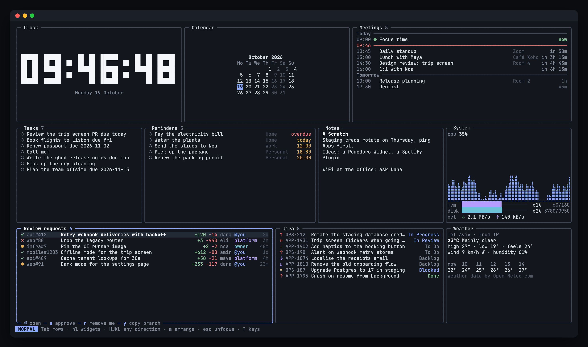

# visor

**A heads-up display for your terminal.**



Stop jumping between Calendar, GitHub, Jira and your notes to figure out what's next. visor shows your next meeting, the PRs waiting for your review, your Jira tickets, today's tasks and reminders, and the weather on one screen, and keeps it fresh while you work.

And you can act on it, not just look at it. Approve a PR, move a ticket along, check off a task or open a meeting straight from the dashboard, without going to the browser.

- **Make it yours.** Drag Widgets around with the mouse or move them with vim keys, resize them, and hide what you don't need.
- **Works with the tools you already use.** GitHub, Jira, your macOS calendar and reminders, and any shell command. Missing something? Write a Plugin in any language.
- **Always one key away.** Run it in Ghostty, or open it over your tab in [herdr](https://herdr.dev) and close it with the same key.
- **Nothing to host.** It's a single app on your machine, and your tokens stay in your system keyring.

## Install

### macOS

```sh
brew install oronbz/tap/visor
```

The cask installs a universal binary, plus `visor-weather`, the Weather Plugin that ships with visor. It needs no Xcode, and it clears the quarantine flag, so macOS doesn't block the first run.

Apple silicon is what I use and test on. Intel Macs get the same universal binary, but they're untested, so it's best effort.

The Meetings and Reminders Widgets ask for Calendar and Reminders access the first time they need it.

### Linux

With [Homebrew on Linux](https://docs.brew.sh/Homebrew-on-Linux):

```sh
brew install oronbz/tap/visor
```

Or take a deb, rpm or apk package from the [latest release](https://github.com/oronbz/visor/releases/latest) (amd64 and arm64):

```sh
sudo dpkg -i visor_X.Y.Z_amd64.deb      # Debian, Ubuntu
sudo rpm -i visor-X.Y.Z-1.x86_64.rpm    # Fedora, RHEL
sudo apk add --allow-untrusted visor_X.Y.Z_x86_64.apk   # Alpine
```

The packages install `visor` and `visor-weather` in `/usr/bin`. Meetings and Reminders are macOS only, everything else works the same.

### Windows

1. Download `visor_X.Y.Z_windows_amd64.zip` (or `arm64`) from the [latest release](https://github.com/oronbz/visor/releases/latest).
2. Extract `visor.exe` and `visor-weather.exe` into the same folder, for example `%LOCALAPPDATA%\Programs\visor`. Keep them together, visor looks for the Weather Plugin next to itself.
3. Add that folder to your `PATH` (Settings > System > About > Advanced system settings > Environment Variables), then open a new terminal and run `visor`.

Use Windows Terminal or another terminal with good Unicode and true colour support. The config lives in `%AppData%\visor\config.toml`.

### From source

```sh
go install github.com/oronbz/visor/cmd/visor@latest
go install github.com/oronbz/visor/cmd/visor-weather@latest
```

Both binaries need to end up in the same directory, which `go install` does for you.

### Update

With Homebrew, on macOS or Linux:

```sh
brew update && brew upgrade visor
```

With a package, the Windows zip or `go install`, install the newer release the same way you installed the first one.

## Getting started

Run `visor`. With no config you get the default Widgets: Clock, Calendar, Meetings (macOS), Tasks, Reminders (macOS), Notes, CPU + memory, PRs, Jira and Weather. Script is opt-in, add it with `ctrl+k` and Add Widget.

- `?` shows every key. `ctrl+k` opens the Action palette, and the footer shows the keys for whatever is focused.
- `q` quits.
- Widgets that need a sign-in or a setting show *needs setup* with a way to fix it right there. GitHub uses your `gh` login or a pasted token. Jira is set up with `visor auth jira`. Tokens go only to your system keyring.

## Configure

Your Widgets and settings live in `~/.config/visor/config.toml` (`$XDG_CONFIG_HOME` is respected, `%AppData%\visor` on Windows). `VISOR_CONFIG` or `--config <path>` point visor at another file. visor never rewrites this file, so it's safe in your dotfiles. The arrangement and sizes you set with the mouse or in arrange mode go to a separate `layout.json` that visor owns.

```sh
visor config default   # print the full commented reference
visor config init      # write that reference to your config path, once
```

The reference lists every option and every Widget type, built-in and installed, with its settings, defaults and why you'd change them. A small config looks like this:

```toml
theme = "terminal"   # or "visor" for visor's own palette

[[widget]]
type = "jira"
site = "acme.atlassian.net"
email = "you@acme.com"

[[widget]]
type = "weather"
id = "paris"
city = "Paris, Texas"
units = "imperial"
```

Any Widget, built-in or from a Plugin, takes your own Actions. Each runs a command, and `{{name}}` fills in a value of the selected Item, shell-quoted. Every Item has `{{id}}`, `{{title}}` and, when it opens a page, `{{url}}`. Script Items have each key they print, and Plugins may name more. Your key wins over the Widget's own:

```toml
[[widget]]
type = "jira"
actions = [
  { key = "f", label = "fix bug", run = "~/bin/fix-bug {{url}}", confirm = true },
]
```

To change colours, override any of the 13 colour tokens for dark or light backgrounds:

```toml
[colors.dark]
accent = "#8aa9ff"

[colors.light]
accent = "#3f63d8"
```

Running instances reload the config as soon as you save it, so you can keep visor open while you edit.

## herdr

### Install with herdr

If you use herdr, this installs visor with Homebrew when it's missing:

```sh
herdr plugin install oronbz/visor/herdr
```

When visor is already on your `PATH` it does nothing. It never upgrades visor and never asks anything. Without Homebrew it stops and prints the other ways to install.

### Update with herdr

The plugin and visor update separately. To get the plugin's latest actions, such as the one-key toggle below:

```sh
herdr plugin update visor
```

The plugin never upgrades visor itself. To upgrade visor, see [Update](#update).

### Open visor with one key

The plugin above also gives herdr a `visor.toggle` action. Bind it in herdr's `config.toml` (`~/.config/herdr/config.toml`) and run `herdr server reload-config`:

```toml
[[keys.command]]
key = "cmd+shift+g"
type = "plugin_action"
command = "visor.toggle"
description = "visor"

[[keys.command]]
key = "prefix+d"
type = "plugin_action"
command = "visor.toggle"
description = "visor"
```

`cmd+shift+g` or `prefix+d` opens visor over the whole tab you're in, and the same key closes it and brings your panes back. herdr's sidebar stays visible and clickable while visor is open. If you switch to another tab and press the key, visor moves to that tab. `q` quits visor too.

visor runs in a real herdr pane here, so right-click opens visor's Action menus, as it does in a tab.

### Open visor as a popup

Without the plugin, a herdr popup works too, but it covers the sidebar and takes every click until it closes:

```toml
[[keys.command]]
key = "cmd+shift+g"
type = "popup"
command = "visor --close-key cmd+shift+g --close-key 'ctrl+b d'"
description = "visor"
width = "100%"
height = "100%"
```

A herdr popup sends every key to visor, so `--close-key` is how visor knows which keys should close it. It takes herdr's key syntax, either a chord (`cmd+shift+g`) or a sequence of two (`'ctrl+b d'`), and you can pass it more than once. If you changed herdr's prefix, change `ctrl+b` to match.

Right-click can't reach a popup, so everything in a right-click menu is on the keyboard too (`ctrl+k`).

### Keep visor in a tab

You can also keep visor open next to your agents. Open a new herdr tab, name it visor and run `visor` in it (no `--close-key` needed, `q` quits). The tab stays there when you detach and come back.

In a tab, visor turns on right-click for its pane when it starts, so right-click opens visor's Action menus, and it gives right-click back to herdr when it quits. visor in a tab and visor opened with a key can run at the same time, and they stay in sync.

## Agent skills

visor comes with two skills for coding agents:

- `visor-configure` sets up your config, Widgets and the herdr keybinds for you.
- `visor-make-plugin` writes a Plugin with you and tests it with `visor plugin check`.

Install them for every agent you have:

```sh
visor skills install
```

This writes the skills to `~/.agents/skills/` (Codex, Cursor, Gemini CLI, opencode, Copilot, Pi) and links them into `~/.claude/skills/` when Claude Code is installed. The skills match your visor version, and visor quietly refreshes them after an upgrade unless you edited them, then it suggests running `visor skills install` again. `visor skills uninstall` removes only the skills visor installed.

You can also install them with the [skills](https://github.com/vercel-labs/skills) CLI. Pin the tag of your visor version (`visor --version`):

```sh
npx skills add oronbz/visor#vX.Y.Z -g
```

Both write the same layout, so either one can replace the other's copy.

## Plugins

A Plugin is a program that adds one or more Widget types. visor starts it and talks to it over stdin and stdout (JSON-RPC), so you can write one in any language. Weather is a Plugin too, it ships with visor.

### Installing Plugins

```sh
visor plugin install bitrise               # an official Plugin, by name
visor plugin install owner/repo            # or owner/repo/subdir, with --ref <tag or branch>
visor plugin list
visor plugin update [name...]
visor plugin uninstall <name>
```

Before it builds anything, `install` shows the Plugin's Widget types and every build command it will run, and asks you to trust it (`-y` skips the question). Installing a Plugin means trusting its code, the same as `herdr plugin install`. Once it's built, `install` adds a Widget of the Plugin's type to `config.toml`, unless one is there already or you pass `--no-widget`. A Plugin with several Widget types gets none; add the ones you want with `ctrl+k` and Add Widget. Plugins go to `~/.local/share/visor/plugins/<name>/`, and running instances pick up an install, update or uninstall without a restart.

A bare name installs that folder of the official repo, [oronbz/visor-plugins](https://github.com/oronbz/visor-plugins), so `visor plugin install bitrise` is `visor plugin install oronbz/visor-plugins/bitrise`. To find more Plugins, look for the [`visor-plugin` topic](https://github.com/topics/visor-plugin) on GitHub.

### Writing a Plugin

The quickest way is to ask your agent to use the `visor-make-plugin` skill. By hand:

1. Make a directory with a `visor-plugin.toml` manifest:

   ```toml
   name = "hello"
   description = "Says hello"
   protocol = 1
   command = ["python3", "hello.py"]

   [[widget]]
   type = "hello"
   title = "Hello"
   description = "A greeting"
   refresh = "5m"

   [[widget.setting]]
   name = "greeting"
   kind = "string"
   default = "Hello"
   description = "What to say"
   ```

   If it needs building, add `[[build]]` steps such as `run = ["go", "build", "-o", "hello"]`. `visor plugin install` runs them in the Plugin's directory, with no shell.

   If it needs a credential, declare it as a setting with `kind = "secret"` instead of storing it yourself. visor asks for it with a "Set <name>" Action, keeps it in your system keyring, and hands it to the Plugin with the Widget's other settings.

2. `visor plugin schema` prints the JSON Schema of the manifest and the protocol for your visor version. Your program answers `initialize`, then `widget/refresh` with a payload, and can push updates on its own.
3. `visor plugin check <dir>` starts it and runs the whole protocol against it (handshake, a Widget's lifecycle, a refresh and an Action), and tells you what's wrong.
4. Load it while you work on it by adding its path to your config:

   ```toml
   [[plugin]]
   path = "~/code/hello"
   ```

5. To publish, push it to GitHub and add the `visor-plugin` topic to the repo. People install it with `visor plugin install you/hello`. To make it an official Plugin that installs by name, open a pull request adding its folder to [oronbz/visor-plugins](https://github.com/oronbz/visor-plugins).

Plugins draw only with visor's 13 colour tokens, never raw colours, so they follow the user's theme.

## Inspiration

visor was inspired by [mirador](https://github.com/jchultarsky/mirador), a personal dashboard for your terminal by Julian Chultarsky (@jchultarsky).
