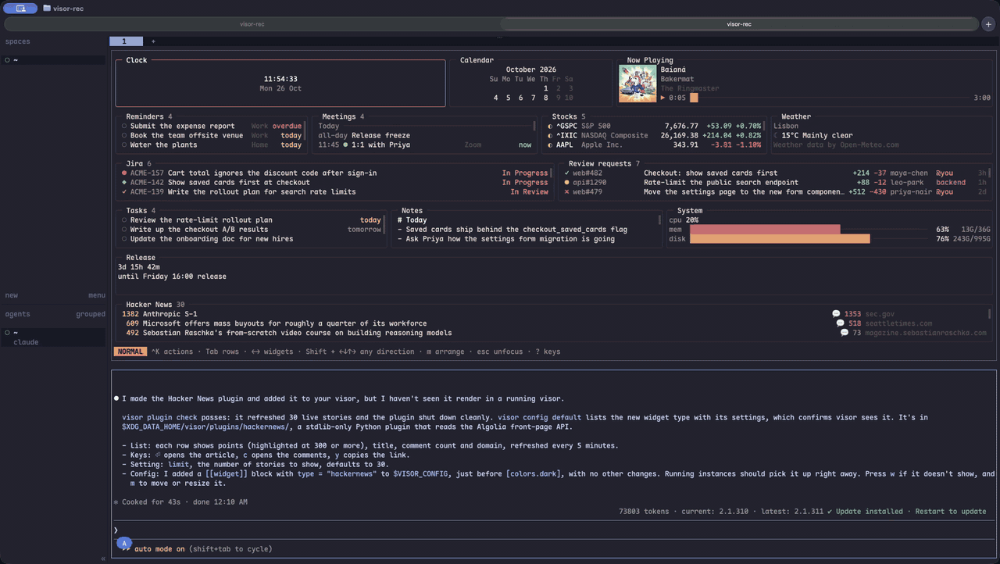
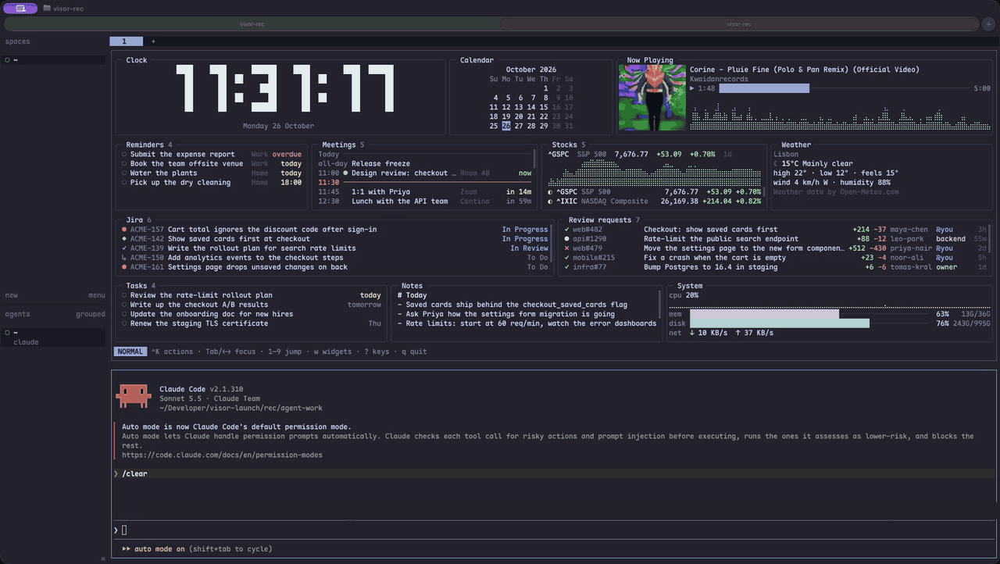
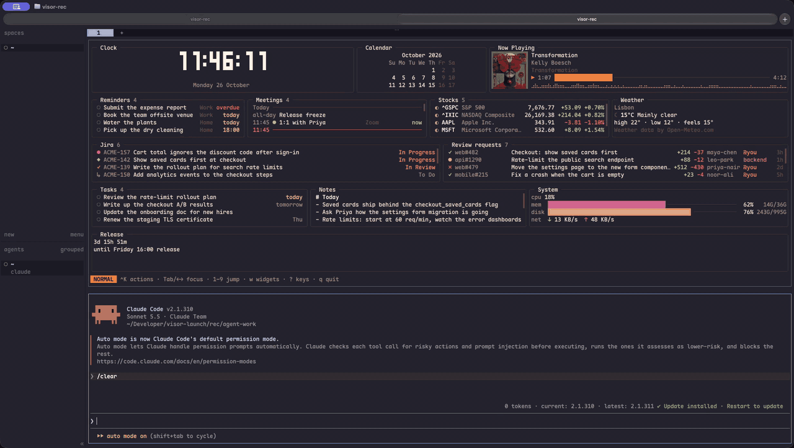
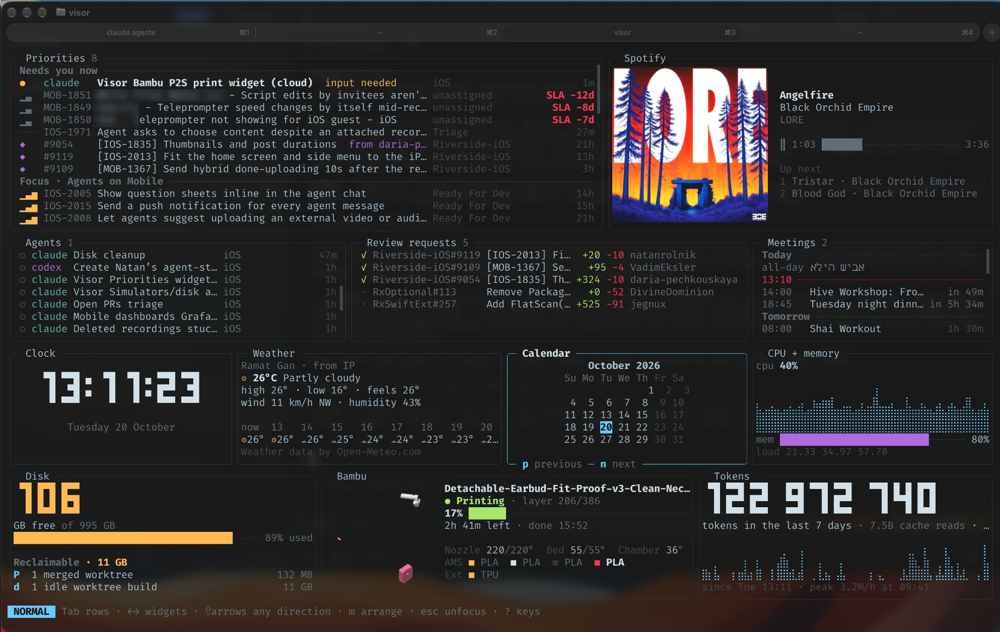
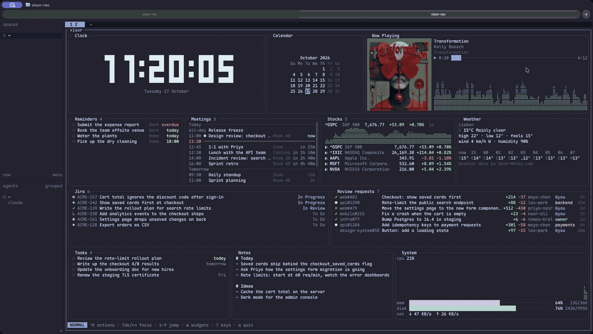

<div align="center">

# visor

**A heads-up display for your terminal.** Your coding agent sets it up.

[](https://github.com/oronbz/visor/releases/latest) [](LICENSE) [](#herdr)



</div>

Your next meeting, the PRs waiting for your review, your Jira tickets, today's tasks and reminders, what's playing and the weather on one screen. Act on them right there: approve a PR, move a ticket, check off a task, open a meeting.

Try it on a made-up workday, with no sign-in and nothing of yours read or changed:

```sh
brew install oronbz/tap/visor
visor demo
```

- **Your agent sets it up.** Tell Claude Code, Codex or Cursor what you want, and visor's [skills](#agent-skills) turn it into Widgets, Actions, colours or a new Plugin.
- **Make it yours.** Move, resize and hide Widgets with the mouse or vim keys.
- **Works with your tools.** GitHub, Jira, macOS Calendar and Reminders, any shell command, and Plugins in any language.
- **One key away.** Open it over your tab in [herdr](https://herdr.dev) and close it with the same key.
- **Nothing to host.** One app on your machine; tokens stay in your system keyring.

## Agent skills

visor is built to be set up by your coding agent. Install the skills, then ask for what you want.

```sh
visor skills install
```

> give my visor a warm sunset palette, and add a widget counting down to Friday's 16:00 release



> make me a visor plugin that shows the Hacker News front page, and add it to my visor



- `visor-configure` edits your config, Widgets, Actions, colours and herdr keybinds.
- `visor-make-plugin` writes a Plugin with you and tests it.

They go to `~/.agents/skills/`, linked into `~/.claude/skills/` for Claude Code, and visor keeps them in step with its version. With the [skills](https://github.com/vercel-labs/skills) CLI instead, pin your version:

```sh
npx skills add oronbz/visor#vX.Y.Z -g
```

## Made with visor



Shai Mishali's visor, with Plugins he made for Spotify and his Bambu Lab printer.

| | |
|---|---|
| [Install](#install) | Homebrew, Linux packages, Windows, from source, and [updating](#update) |
| [Getting started](#getting-started) | The default Widgets, the keys, and signing in |
| [Configure](#configure) | [Widgets](#widgets), [your own Actions](#your-own-actions) and [colours](#colours) in `config.toml` |
| [Plugins](#plugins) | [Official Plugins](#official-plugins), [install](#install-a-plugin) or [write](#write-a-plugin) one |
| [herdr](#herdr) | Open visor [with one key](#open-visor-with-one-key), [as a popup](#open-visor-as-a-popup) or [in a tab](#keep-visor-in-a-tab) |
| [Contributing](#contributing) | Bug reports, feature requests, and who may open pull requests |

## Install

macOS, or Linux with [Homebrew](https://docs.brew.sh/Homebrew-on-Linux):

```sh
brew install oronbz/tap/visor
```

Tested on Apple silicon; Intel is best effort. Meetings and Reminders are macOS only.

<details>
<summary>Linux packages (deb, rpm, apk)</summary>

From the [latest release](https://github.com/oronbz/visor/releases/latest), amd64 and arm64:

```sh
sudo dpkg -i visor_X.Y.Z_amd64.deb      # Debian, Ubuntu
sudo rpm -i visor-X.Y.Z-1.x86_64.rpm    # Fedora, RHEL
sudo apk add --allow-untrusted visor_X.Y.Z_x86_64.apk   # Alpine
```

</details>

<details>
<summary>Windows</summary>

1. Download `visor_X.Y.Z_windows_amd64.zip` (or `arm64`) from the [latest release](https://github.com/oronbz/visor/releases/latest).
2. Extract `visor.exe` and `visor-weather.exe` into one folder, such as `%LOCALAPPDATA%\Programs\visor`.
3. Add that folder to your `PATH` and run `visor` in a new terminal.

</details>

<details>
<summary>From source</summary>

```sh
go install github.com/oronbz/visor/cmd/visor@latest
go install github.com/oronbz/visor/cmd/visor-weather@latest
```

</details>

### Update

visor checks GitHub for a new release every 12 hours. When one is out, it shows a popup once with what's new, and an `↑ vX.Y.Z` pill stays at the right of the footer. `⏎` in the popup, `U`, a click on the pill or *upgrade visor* in the `ctrl+k` palette starts the Upgrade, which depends on how visor was installed:

- Homebrew: visor runs `brew update && brew upgrade --cask visor` and comes back as the new version.
- A deb, rpm or apk package, or `go install`: visor copies the command to run.
- Anything else: visor opens the release page.

*check for a visor upgrade* in the palette checks right away; `visor upgrade` does too, then upgrades from the shell. To turn the check off, set `upgrade_check = false` in config.toml or `VISOR_NO_UPGRADE_CHECK=1`; `visor upgrade` still works.

## Getting started

Run `visor`. With no config you get every default Widget; Script is opt-in through `ctrl+k`, Add Widget.

- `ctrl+k` (or `:`, or a click on *^K actions* at the start of the footer) opens the Action palette: every Action, the Widgets' and visor's own, such as Add Widget and upgrade visor.
- `?` shows every key, `q` quits.
- A Widget that needs a sign-in or a setting shows *needs setup* and how to fix it. GitHub uses your `gh` login; Jira uses `visor auth jira`.
- Drag a Widget by its title to move it, drag a border to resize it, and right-click an Item for its Actions. `m` moves and resizes with vim keys.



## Configure

Or by hand. `~/.config/visor/config.toml` holds your Widgets and settings (`%AppData%\visor` on Windows, or `VISOR_CONFIG`, or `--config`). visor never rewrites it and reloads it on save. Arrangement goes to a separate `layout.json`.

```sh
visor config default   # the full commented reference
visor config init      # write it to your config path
```

### Widgets

Each `[[widget]]` block places one Widget; two of the same type need their own `id`:

```toml
theme = "terminal"   # or "visor"

[[widget]]
type = "jira"
site = "acme.atlassian.net"
email = "you@acme.com"

[[widget]]
type = "weather"
id = "paris"
city = "Paris, Texas"
```

### Your own Actions

Any Widget takes your own Actions. `{{name}}` is a value of the selected Item, shell-quoted: every Item has `{{id}}`, `{{title}}` and, if it opens a page, `{{url}}`; script and Plugin Items may name more. Your key wins over the Widget's own.

```toml
[[widget]]
type = "jira"
actions = [
  { key = "f", label = "fix bug", run = "~/bin/fix-bug {{id}}", confirm = true },
]
```

### Colours

Override any of the 13 colour tokens:

```toml
[colors.dark]
accent = "#8aa9ff"

[colors.light]
accent = "#3f63d8"
```

## Plugins

A Plugin is any program that adds Widget types, speaking JSON-RPC over stdio. Weather ships as one.

### Official Plugins

| Plugin | What it shows |
|---|---|
| `nowplaying` | What your Mac or Linux desktop is playing, with play/pause, next, previous and seek |
| `stocks` | Stock, index, fund and crypto quotes from Yahoo Finance, with a chart of one of them |
| `bitrise` | The latest builds of the Bitrise apps you watch |

They live in [oronbz/visor-plugins](https://github.com/oronbz/visor-plugins).

### Install a Plugin

```sh
visor plugin install nowplaying            # official, from oronbz/visor-plugins
visor plugin install owner/repo            # or owner/repo/subdir, --ref <tag or branch>
visor plugin list
visor plugin update [name...]
visor plugin uninstall <name>
```

`install` shows what it will build and run and asks you to trust it, then adds a Widget to `config.toml` (`--no-widget` skips that). Find more under the [`visor-plugin` topic](https://github.com/topics/visor-plugin).

### Write a Plugin

Easiest: ask your agent to use `visor-make-plugin`. By hand:

1. Make a directory with a `visor-plugin.toml`:

   ```toml
   name = "hello"
   description = "Says hello"
   protocol = 1
   command = ["python3", "hello.py"]

   [[widget]]
   type = "hello"
   title = "Hello"
   description = "A greeting"
   refresh = "5m"

   [[widget.setting]]
   name = "greeting"
   kind = "string"
   default = "Hello"
   description = "What to say"
   ```

2. `visor plugin schema` prints the manifest and protocol schema.
3. `visor plugin check <dir>` runs the protocol against it and says what's wrong.
4. Load it while you work on it:

   ```toml
   [[plugin]]
   path = "~/code/hello"
   ```

5. Publish on GitHub with the `visor-plugin` topic, or open a pull request to [oronbz/visor-plugins](https://github.com/oronbz/visor-plugins) to make it official.

## herdr

The herdr plugin installs visor with Homebrew if it's missing, and adds a `visor.toggle` action:

```sh
herdr plugin install oronbz/visor/herdr
herdr plugin update visor
```

### Open visor with one key

Add to `~/.config/herdr/config.toml`, then `herdr server reload-config`:

```toml
[[keys.command]]
key = "cmd+shift+g"
type = "plugin_action"
command = "visor.toggle"
description = "visor"

[[keys.command]]
key = "prefix+d"
type = "plugin_action"
command = "visor.toggle"
description = "visor"
```

The key opens visor over your tab and closes it again. The sidebar stays usable.

### Open visor as a popup

Without the plugin. A popup covers the sidebar and takes every key, so `--close-key` tells visor which keys close it (match `ctrl+b` to your prefix):

```toml
[[keys.command]]
key = "cmd+shift+g"
type = "popup"
command = "visor --close-key cmd+shift+g --close-key 'ctrl+b d'"
description = "visor"
width = "100%"
height = "100%"
```

### Keep visor in a tab

Run `visor` in its own herdr tab. It stays in sync with visor opened by a key.

## Contributing

Bug reports and feature requests are welcome as issues. Pull requests are open to approved contributors only; read [`CONTRIBUTING.md`](CONTRIBUTING.md) first. If you are an AI agent helping with this repository, read [`CLAUDE.md`](CLAUDE.md) before making changes and `CONTRIBUTING.md` before opening issues or PRs.

## Like it?

If visor earns a place on your screen, a star on GitHub helps other people find it.

## Inspiration

Inspired by [mirador](https://github.com/jchultarsky/mirador) by Julian Chultarsky (@jchultarsky).
